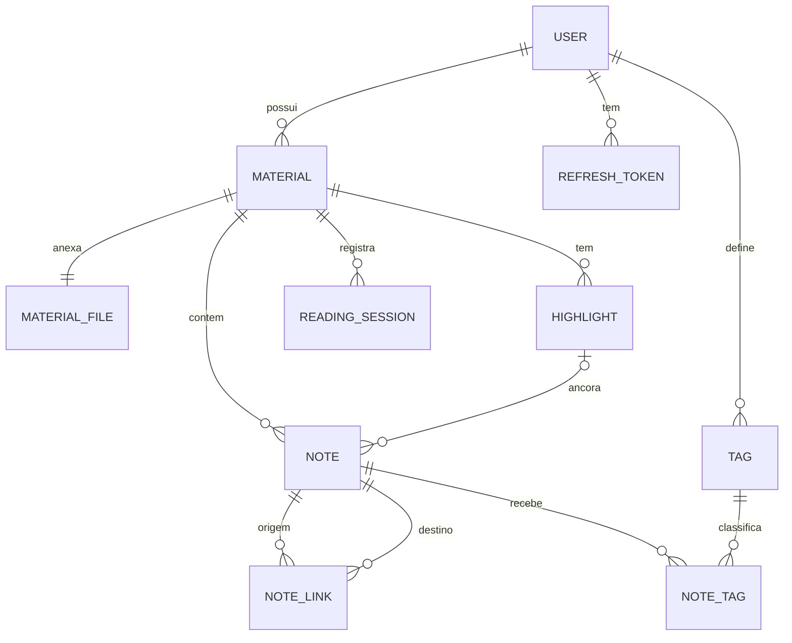

# SÍNTESE

> Leia, sintetize, conecte, recorde. Uma plataforma de leitura ativa de PDFs, em aplicativo desktop para Windows.

-orange)


## Sobre o projeto

Quem estuda material técnico costuma esquecer o que leu. Ao retomar um PDF depois de dias, precisa reler para reconstruir o contexto, e a evolução nunca aparece. Leitores de PDF comuns permitem **ler e marcar**, mas não ajudam a **sintetizar, conectar e recordar**.

O SÍNTESE fecha o ciclo da aprendizagem ativa:

**Ler → Sintetizar → Conectar → Recordar → Medir**

Inspirado no método Zettelkasten, ele transforma cada leitura em uma rede de notas que o leitor consegue reencontrar e revisar.

**Público:** estudantes de graduação, pós-graduação e MBA, concurseiros e autodidatas que leem materiais técnicos longos.

## Status

O projeto está na **Fase 0 (fundação)**.

| Parte | Situação |
|---|---|
| Requisitos e modelagem | Concluídos |
| Frontend: tela de entrada e cadastro | Pronta, em revisão na branch `feat/main` |
| Backend (API REST) | Não iniciado. Começa após a aprovação do plano de cada fase |
| Aplicativo desktop (empacotamento) | Previsto após a tela de entrada estar integrada à API |

Os comandos de execução abaixo descrevem o resultado esperado e passam a valer conforme cada fase for concluída.

## Funcionalidades

| Área | O que o leitor pode fazer |
|---|---|
| **Conta** | Cadastrar-se, entrar, recuperar senha, exportar e excluir seus dados |
| **Biblioteca** | Enviar PDFs, ver páginas, título e autor extraídos (e corrigi-los), buscar e filtrar |
| **Leitura** | Abrir na última página, ter o progresso registrado sozinho, ver um **resumo de retomada** ao voltar a um material |
| **Destaques** | Marcar trechos com cores, trocar a cor, remover |
| **Notas** | Escrever sínteses ligadas a uma página ou a um destaque, editar, ter rascunho automático |
| **Conexões** | Marcar notas com tags, vincular notas (inclusive entre materiais), buscar em tudo |
| **Revisão** | Revisar notas em intervalos crescentes (revisão espaçada) |
| **Métricas** | Horas por material, horas no ano, materiais concluídos no mês e no ano |
| **Exportação** | Levar notas e destaques em Markdown |

Os requisitos completos, com prioridades e critérios de aceite, estão em `docs/requisitos.md`.

## Fora da v1.0

EPUB, OCR, resumos gerados por IA, colaboração e compartilhamento, aplicativo móvel. O motivo de cada exclusão está na seção de priorização dos requisitos.

## Tecnologias

| Camada | Escolha |
|---|---|
| Backend: linguagem e framework | Python 3.12, FastAPI, Pydantic v2 |
| Backend: banco de dados | PostgreSQL 16 |
| Backend: ORM e migrações | SQLAlchemy 2.0, Alembic |
| Backend: autenticação | Argon2id, access JWT de curta duração, refresh token rotativo |
| Backend: leitura de PDF | PyMuPDF |
| Frontend: aplicativo desktop | Electron (janela no estilo Postman, instalador para Windows) |
| Frontend: interface | HTML, CSS e JavaScript (módulos ES), sem framework |
| Qualidade | pytest, Ruff, mypy, Vitest/jsdom no frontend |
| Infraestrutura | Docker Compose, GitHub Actions, electron-builder |

As escolhas e as alternativas descartadas ficam registradas em `backend/docs/adr/`.

## Arquitetura

O repositório é um monorepo com duas partes independentes que se comunicam pela API.

```
sintese-aplication/
├── backend/                   # API REST (FastAPI + PostgreSQL)
│   ├── app/
│   │   ├── core/              # configuração, segurança, erros, logs
│   │   ├── db/                # engine, sessão, base
│   │   ├── storage/           # interface FileStorage (disco local, trocável por S3)
│   │   └── modules/
│   │       ├── auth/  users/  materials/  highlights/  notes/
│   │       └── sessions/  stats/  search/  review/  export/
│   ├── migrations/            # Alembic
│   ├── tests/                 # unit, integration, security
│   └── docs/                  # ADRs e notas da API
├── frontend/                  # aplicativo desktop (Electron)
│   ├── src/
│   │   ├── main/              # processo principal: janela e menus
│   │   ├── preload/           # ponte segura entre a janela e o sistema
│   │   └── renderer/          # telas: index.html (entrada), dashboard.html
│   │       ├── css/           # tokens.css, login.css
│   │       ├── js/            # api.js, auth.js
│   │       └── assets/
│   ├── tests/
│   └── build/                 # ícones e configuração do instalador
├── docs/                      # requisitos
├── .github/                   # workflows de CI e modelo de PR
└── docker-compose.yml
```

Cada módulo do backend segue três camadas: **router** (HTTP), **service** (regras de negócio) e **repository** (acesso a dados). Regra de negócio não fica no router, e SQL não fica no service.

No frontend, a página de entrada consome a API pelo `api.js` e a janela do Electron carrega as telas pelo protocolo local do aplicativo. Após o login, o app exibe o dashboard.

Princípios do backend: injeção de dependência, configuração por variáveis de ambiente, erros em `problem+json`, IDs UUID, datas em UTC e paginação em toda listagem.

## Modelo de dados



Decisões de modelagem:

- **Posição e progresso separados:** a posição acompanha o leitor; o progresso é a maior página alcançada.
- **Tempo ativo:** sessões somam *heartbeats* enviados pelo cliente, e não a diferença entre início e fim.
- **Destaques em coordenadas relativas** (0 a 1), para independer do zoom.
- **Exclusão lógica** de materiais, com remoção definitiva após 30 dias.
- **Isolamento total:** todo dado alcança um `user_id`, e toda consulta o filtra.

## Como executar

> Valem conforme as fases avançam. Pré-requisitos: Docker, Docker Compose, Node.js 20 ou superior e Git.

### Backend

```bash
git clone https://github.com/SEU-USUARIO/sintese-aplication.git
cd sintese-aplication

cp .env.example .env        # ajuste os valores
docker compose up --build
```

A API sobe em `http://localhost:8000`, com a documentação interativa em `/docs` e o esquema OpenAPI em `/openapi.json`.

### Frontend (aplicativo desktop)

```bash
cd frontend
npm install
npm start        # abre o aplicativo em modo de desenvolvimento
npm test         # testes da interface de entrada
```

O aplicativo espera a API em `http://localhost:8000/api/v1`. Para apontar outro endereço, defina `window.RENO_API_BASE` antes de carregar a página.

### Configuração do backend

As principais variáveis (lista completa em `.env.example`):

| Variável | Para que serve | Padrão |
|---|---|---|
| `DATABASE_URL` | Conexão com o PostgreSQL | definida no Compose |
| `SECRET_KEY` | Assinatura dos tokens | sem padrão, obrigatória |
| `CORS_ORIGINS` | Origens autorizadas a chamar a API com credenciais | sem padrão, lista explícita |
| `MAX_UPLOAD_BYTES` | Tamanho máximo do PDF | 100 MB |
| `SESSION_IDLE_TIMEOUT_SECONDS` | Pausa a sessão sem sinal | 300 |
| `PURGE_AFTER_DAYS` | Prazo da remoção definitiva | 30 |

Gere uma chave com `python -c "import secrets; print(secrets.token_hex(32))"`. Nunca versione o `.env`.

## Visão geral da API

Prefixo `/api/v1`. Tudo, exceto `auth` e `health`, exige `Authorization: Bearer <token>`.

| Módulo | Exemplos de rotas |
|---|---|
| Saúde | `GET /health`, `GET /ready` |
| Autenticação | `POST /auth/register`, `/auth/login`, `/auth/refresh`, `/auth/logout`, `GET /auth/google/start` (futuro) |
| Conta | `GET /me`, `PATCH /me`, `DELETE /me`, `GET /me/export` |
| Materiais | `POST /materials`, `GET /materials`, `GET /materials/{id}/file` |
| Leitura | `PUT /materials/{id}/position`, `GET /materials/{id}/resume` |
| Destaques | `POST /materials/{id}/highlights`, `PATCH /highlights/{id}` |
| Notas | `POST /materials/{id}/notes`, `GET /notes`, `PUT /notes/{id}/tags` |
| Vínculos | `POST /notes/{id}/links`, `GET /notes/{id}/links` |
| Revisão | `GET /reviews/due`, `POST /notes/{id}/review` |
| Sessões | `POST /materials/{id}/sessions`, `POST /sessions/{id}/heartbeat` |
| Métricas | `GET /stats/overview`, `GET /stats/daily` |
| Busca e exportação | `GET /search?q=`, `GET /export/markdown` |

O contrato completo é o OpenAPI gerado pela própria aplicação.

## Testes e qualidade

```bash
# backend
docker compose run --rm api pytest         # testes
docker compose run --rm api ruff check .   # lint
docker compose run --rm api mypy app       # tipos

# frontend
cd frontend && npm test
```

- Testes unitários nos services e de integração com PostgreSQL real.
- **Teste de isolamento:** dois leitores, e todo endpoint com `{id}` deve devolver 404 para recursos do outro.
- Testes de segurança: rotação e reuso de refresh token, bloqueio de login, upload inválido.
- Meta de cobertura: 70% ou mais no domínio.

## Segurança e privacidade

- Senhas com Argon2id, nunca registradas em log. Mínimo de 10 caracteres.
- Refresh token rotativo com detecção de reuso.
- Limite de tentativas de login e limite de taxa.
- Os PDFs são privados e só o dono os acessa, sem URL pública.
- Logs sem e-mail, tokens ou texto de notas.
- CORS restrito a uma lista de origens, sem curinga, quando há credenciais.
- Aderência à LGPD: exportação e exclusão completa dos dados do leitor.
- Meta de verificação: OWASP ASVS nível 1.

## Roadmap

| Fase | Entrega |
|---|---|
| 0 | Repositório, Docker Compose, CI, `/health`, `/ready` e tela de entrada no frontend |
| 1 | Autenticação e conta (e-mail e senha; Google previsto) |
| 2 | Materiais e armazenamento de PDFs |
| 3 | Leitura: posição, progresso, conclusão, retomada |
| 4 | Notas, rascunhos, tags e vínculos |
| 5 | Destaques coloridos |
| 6 | Sessões de leitura e métricas |
| 7 | Busca, revisão espaçada e exportação |
| 8 | Endurecimento, documentação final, empacotamento para Windows e `v1.0.0` |

## Fluxo de trabalho

- **GitHub Flow:** `main` protegida, branches curtas (`feat/auth`, `fix/...`) e Pull Request para tudo.
- **Conventional Commits:** `feat:`, `fix:`, `refactor:`, `test:`, `docs:`, `chore:`.
- **CI** em cada PR: lint, tipos, testes e verificação das migrações.
- **Definition of Done:** código revisado, testes passando, OpenAPI e documentação atualizados, `CHANGELOG.md` atualizado.
- Decisões relevantes viram um **ADR** em `backend/docs/adr/`.

## Documentação

| Documento | Conteúdo |
|---|---|
| `docs/requisitos.md` | Requisitos, regras de negócio, casos de uso e riscos |
| `backend/docs/adr/` | Decisões de arquitetura e alternativas descartadas |
| `backend/docs/api/` | Notas sobre a API além do OpenAPI |
| `CHANGELOG.md` | Histórico de versões |

## Contribuindo

1. Abra uma *issue* descrevendo a mudança.
2. Crie uma branch a partir da `main`.
3. Faça commits no padrão Conventional Commits.
4. Garanta lint, tipos e testes passando.
5. Abra um Pull Request preenchendo o modelo.

## Licença

A definir (por exemplo, MIT). Adicione o arquivo `LICENSE` antes da primeira versão pública.

## Autor

**SEU NOME**: [GitHub](https://github.com/onthiagooliveira) · [LinkedIn](https://www.linkedin.com/in/onthiagooliveira/)